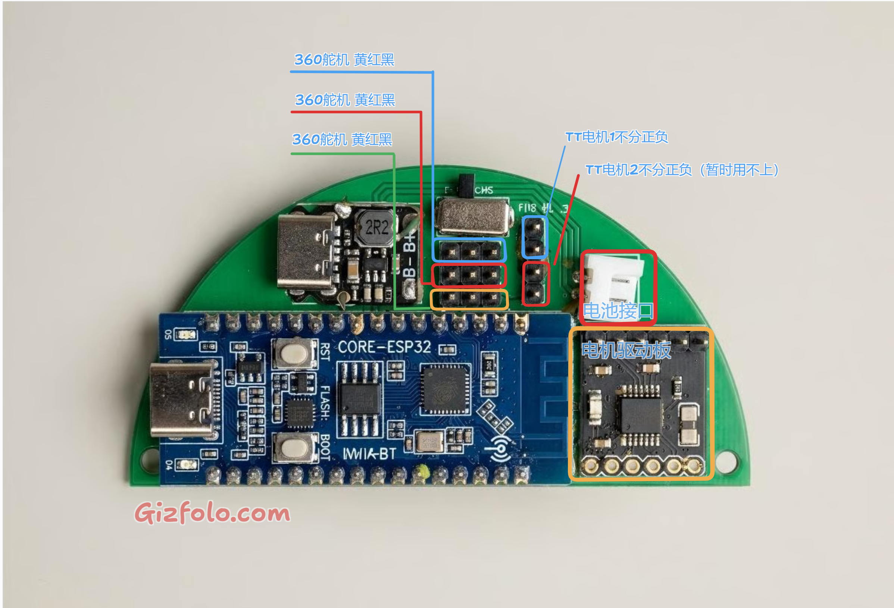

# ESP32-C3 Mini Robo Arm 控制模块

[English](README_EN.md) | 简体中文

这是一个基于 ESP32-C3 的小型机械臂控制固件。设备通过浏览器页面控制 2 个 360° 连续旋转舵机、1 个 180° 舵机和 1 个 TT 直流电机，网页资源保存在 LittleFS 中，控制指令通过 WebSocket 实时发送。

> 本文档以当前仓库代码为准。固件支持 STA、AP 和 STA 失败后的配置热点模式。

## 项目展示


| 内部结构 | 控制板 |
| --- | --- |
|  |  |

在线串口终端：<https://googlechromelabs.github.io/serial-terminal/>

## 当前功能

- 响应式中英文 Web 控制面板
- WebSocket 实时控制，服务端每秒广播一次心跳
- 短按按设定时长运行，网页可设置 `0.1～5.0` 秒
- 长按超过 300 ms 后连续运行，松开即停止；固件强制限制最长 10 秒
- 页面紧急停止、单设备停止和 WebSocket 断线自动停机
- TT 电机非阻塞 PWM 缓启动，降低启动冲击且不延迟网络处理
- 运动期间每 500 ms 续租，超过 1.5 秒未收到续租指令则自动停机
- 固件严格校验消息类型、电机、速度、角度和运行时间
- 180° 舵机支持左右步进、回中和角度滑块
- 控制参数和界面语言保存在浏览器 `localStorage`
- WiFi 配置保存在 ESP32 `Preferences`（NVS）中
- 网络配置页可扫描周边 WiFi，显示信号强度和加密状态，点击结果自动填入 SSID
- D4/D5 双 LED 指示网络状态，所有串口运行日志使用英文输出
- 5 分钟未收到 WebSocket JSON 指令后进入深度睡眠

## 硬件与引脚

| 功能 | 代码定义 | GPIO |
| --- | --- | ---: |
| 360° 舵机 1 | `SERVO1_PIN` | 2 |
| 360° 舵机 2 | `SERVO2_PIN` | 3 |
| 180° 舵机 | `SERVO3_PIN` | 10 |
| TT 电机驱动输入 1 | `MOTOR_IN1` | 6 |
| TT 电机驱动输入 2 | `MOTOR_IN2` | 7 |
| D4 状态 LED（高电平点亮） | `LED_D4_PIN` | 12 |
| D5 状态 LED（高电平点亮） | `LED_D5_PIN` | 13 |

连续旋转舵机使用 `1000～2000 μs` 脉宽，两个停止点当前均为 `1500 μs`。如果舵机停止时仍缓慢转动，请在 `src/main.cpp` 中微调 `SERVO1_STOP_US` 和 `SERVO2_STOP_US`。

TT 电机必须通过合适的电机驱动电路连接 GPIO 6/7，不能由 ESP32 GPIO 直接驱动。舵机和电机建议使用独立、容量足够的电源，并与 ESP32 共地。

### 控制板接线参考



## 构建环境与依赖

工程使用 PlatformIO，当前环境为：

- 环境名：`airm2m_core_esp32c3`
- Platform：`espressif32@6.7.0`
- Board：`airm2m_core_esp32c3`
- Framework：Arduino
- 分区表：`no_ota.csv`
- 文件系统：LittleFS
- 串口波特率：`115200`

`platformio.ini` 中声明的依赖：

- `madhephaestus/ESP32Servo@3.0.9`
- `links2004/WebSockets@2.7.2`
- `ESP32Async/ESPAsyncWebServer@3.12.1`
- `ESP32Async/AsyncTCP@3.5.0`
- `bblanchon/ArduinoJson@6.21.6`

## 编译与烧录

> **重要：** 除了烧录固件，还必须将 `data/` 目录中的网页资源单独烧录到 LittleFS。否则控制页面可能无法打开，或者设备仍会显示旧版页面。请依次执行下面的固件上传和 `uploadfs` 步骤。

1. 安装仓库固定的 PlatformIO Core 版本：

   ```bash
   python -m pip install -r requirements.txt
   ```

2. 使用 VS Code + PlatformIO 打开本目录。
3. 编译固件：

   ```bash
   pio run -e airm2m_core_esp32c3
   ```

4. 烧录固件：

   ```bash
   pio run -e airm2m_core_esp32c3 -t upload
   ```

5. 将 `data/` 中的网页资源烧录到 LittleFS：

   ```bash
   pio run -e airm2m_core_esp32c3 -t uploadfs
   ```

6. 打开串口监视器查看连接结果和设备 IP：

   ```bash
   pio device monitor -b 115200
   ```

串口日志使用英文和 ASCII 状态标记（例如 `[OK]`、`[WARN]`和 `[ERROR]`），避免因串口终端编码不同出现乱码。

固件和 LittleFS 需要分别烧录；若只烧录固件，控制网页可能不存在或仍是旧版本。修改 `data/` 中的 HTML、CSS 或 JavaScript 后，必须再次执行 `uploadfs`。

## WiFi 启动行为

当前 `setupWiFi()` 的实际启动顺序如下：

1. 从 NVS 命名空间 `robot-wifi` 读取已保存的 `mode`、`ssid` 和 `password`。
2. 保存模式为 `ap` 时，直接启动开放 AP 热点。
3. STA 模式存在已保存的 SSID 时，尝试连接该网络，超时为 15 秒。
4. 如果没有已保存的 SSID，并且源码设置了默认凭据，则尝试默认网络。
5. 没有可用凭据或 STA 连接失败时，自动启动配置热点。

源码中的 `DEFAULT_STA_SSID` 和 `DEFAULT_STA_PASSWORD` 默认均为空，不包含私人网络凭据。

AP 信息：

- SSID：`ESP32-ROBOTARM-<芯片ID>`
- 密码：无
- 地址：`192.168.4.1`
- DNS Captive Portal 会将常见系统探测请求引导到控制页面。
- `/wifi-reset` 清空 NVS 后重启，设备会进入配置热点。

配置热点或 AP 模式下访问 `http://192.168.4.1/`。STA 连接成功后，从串口日志或路由器设备列表找到设备 IP，然后访问：

```text
http://<设备IP>/
```

WebSocket 服务地址为：

```text
ws://<设备IP>:81/
```

### 扫描和选择 WiFi

在高级设置的“WiFi 设置”区域中：

1. 将工作模式选为“连接局域网”。
2. 点击 SSID 输入框旁的“扫描 WiFi”。
3. 扫描结果会显示网络名称、RSSI 和加密状态。相同 SSID 只保留信号最强的一项，最多显示 20 项。
4. 点击目标网络，SSID 会自动填入，然后输入密码并保存。

扫描采用异步方式。设备处于配置热点或 AP 模式时，扫描期间会使用 AP+STA 模式，以便保持配置页连接。

## Web 控制逻辑

- TT 电机默认 PWM 为 `240`，网页可调范围为 `120～255`。
- 两个连续旋转舵机默认速度值为 `130`，网页可调范围为 `30～150`；反方向由前端发送 `180 - speed`。
- 短按运行时间默认 `0.1` 秒，可调范围为 `0.1～5.0` 秒。
- 长按阈值为 300 ms，最长运行 10 秒；松开、指针取消或丢失捕获时发送停止命令。
- 180° 舵机启动时回到 90°，默认步进 30°；角度范围 `0～180°`，步进范围 `5～90°`。
- 紧急停止和 WebSocket 断开会停止两个连续旋转舵机及 TT 电机。180° 舵机保持当前位置。

## WebSocket 协议

客户端连接端口 `81`，消息使用 JSON 文本。

短时运行连续旋转舵机：

```json
{"type":"run_duration","motor":"servo1","speed":130,"duration":100}
```

短时正转 TT 电机：

```json
{"type":"run_duration","motor":"motor","speed":240,"duration":500,"forward":true}
```

开始连续运行（固件最多运行 10 秒）：

```json
{"type":"start_continuous","motor":"servo2","speed":130}
```

停止单个设备：

```json
{"type":"stop","motor":"motor"}
```

设置 180° 舵机角度：

```json
{"type":"servo180","angle":90}
```

紧急停止：

```json
{"type":"emergency_stop"}
```

运动续租（网页在执行器运行期间每 500 ms 自动发送）：

```json
{"type":"control_keepalive"}
```

如果连续 1.5 秒未收到续租消息，固件将停止所有正在运行的连续舵机和 TT 电机。

服务端心跳示例：

```json
{"type":"heartbeat","mode":"STA","configuredMode":"sta","configurationPortal":false,"timestamp":12345,"uptime":12,"ssid":"YOUR_WIFI","ip":"192.168.1.100","rssi":-48}
```

自动停止后，服务端广播：

```json
{"type":"motor_stopped","motor":"servo1","reason":"run_limit"}
```

紧急停止或 WebSocket 断开时，服务端广播：

```json
{"type":"safety_stop","reason":"emergency_stop"}
```

非法或越界指令会返回：

```json
{"type":"command_error","error":"out_of_range"}
```

其中 `motor` 可为 `servo1`、`servo2` 或 `motor`；`duration` 单位为毫秒，允许范围为 `1～5000`。AP 模式心跳还会包含 `clients` 字段。

## HTTP API

### `GET /wifi-info`

返回当前模式、已配置模式、连接状态、SSID、IP 和信号信息，不返回密码。

### `GET /wifi-scan?start=1`

启动一次异步 WiFi 扫描。扫描已启动或正在进行时返回：

```json
{"scanning":true}
```

### `GET /wifi-scan`

查询扫描状态。扫描完成后返回去重后的网络列表：

```json
{
  "scanning": false,
  "networks": [
    {"ssid": "YOUR_WIFI", "rssi": -48, "secure": true}
  ]
}
```

结果按扫描信号顺序取前 20 个不重复的非隐藏 SSID。

### `POST /wifi-config`

接收表单字段（`application/x-www-form-urlencoded`）：

- `mode=sta|ap`
- STA 模式需要 `ssid`，`password` 可为空

保存成功后返回 JSON，立即停止执行器，并在约 1.2 秒后重启。保存的 AP/STA 模式会在重启后生效。

### `POST /wifi-reset`

清空 `robot-wifi` NVS 命名空间并重启。

## 状态与安全机制

- LED 上电自检：D4 和 D5 同时点亮 1 秒后熄灭。
- 网络可用：D4 每 2 秒翻转一次，D5 保持熄灭。STA 模式以 WiFi 连接状态为准；AP 模式以是否有客户端接入为准。
- 网络不可用：D4 和 D5 每 500 ms 交替点亮，包括 STA 初始连接等待阶段。
- 进入深度睡眠前，D4 和 D5 均会熄灭。
- WebSocket 客户端断开：立即停止两个连续旋转舵机和 TT 电机。
- 定时运行及连续运行上限到达：固件主动停止对应设备并广播状态。
- 运动看门狗：网页每 500 ms 发送一次 `control_keepalive`，超过 1.5 秒未收到则立即停机。
- TT 电机启动：使用非阻塞状态机，以 PWM 10 为步长、每 8 ms 缓升到目标速度。
- WiFi 配置或重置：发送响应后先停止所有执行器，再延迟重启。
- 无指令休眠：启动后或最后一条可解析的 WebSocket JSON 消息之后 5 分钟，设备停止执行器、关闭网络并进入深度睡眠。
- 当前没有配置深度睡眠唤醒源，休眠后需要外部复位或重新上电。

## 目录结构

```text
.
├─ src/main.cpp          固件入口、网络服务和执行器控制
├─ data/index.html       Web 控制页面
├─ data/style.css        页面样式
├─ data/script.js        前端控制、状态与 WiFi 配置逻辑
├─ docs/                 项目照片及中英文接线说明
├─ LICENSE               MIT 开源许可证
├─ requirements.txt      固定 PlatformIO Core 版本
└─ platformio.ini        PlatformIO 构建与依赖配置
```

## 开源硬件与教程

- 3D 模型结构件：[MakerWorld 模型](https://makerworld.com.cn/zh/models/1760642)（选择“适配第三方舵机 + TT 马达版本”）
- PCB 控制板：[嘉立创开源硬件平台](https://oshwhub.com/tonytang2/esp32-armbot)
- BOM、组装、烧录与视频教程：[Gizfolo Robot Arm 教程](https://gizfolo.com/p/robot-arm)
- 项目演示视频：[YouTube](https://www.youtube.com/watch?v=KMd7N6MSbM0)

本项目为开源 DIY 机械臂控制模块，欢迎交流与复刻。

## License

本项目使用 [MIT License](LICENSE)。第三方依赖继续遵循各自的许可证。
