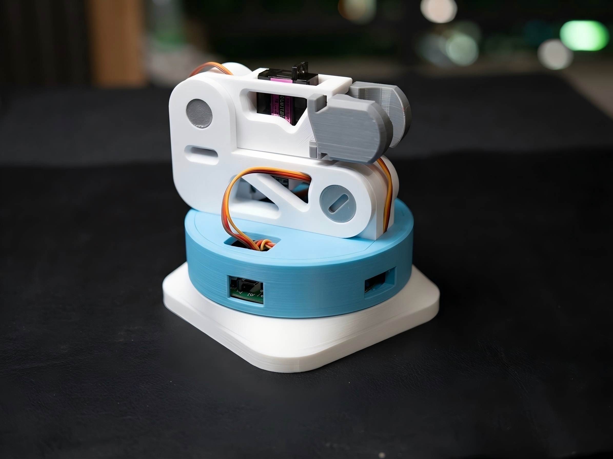
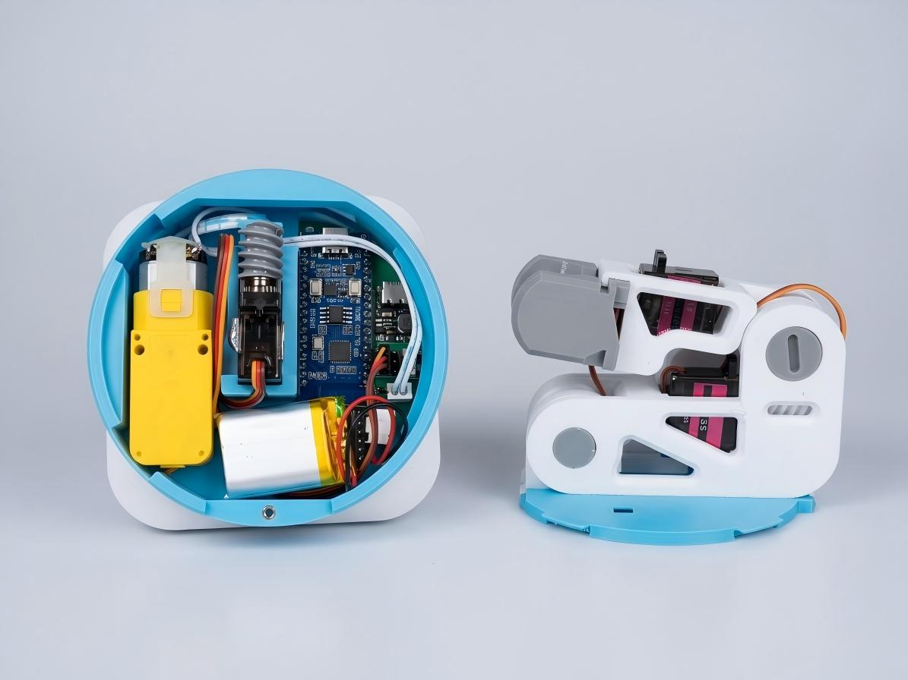
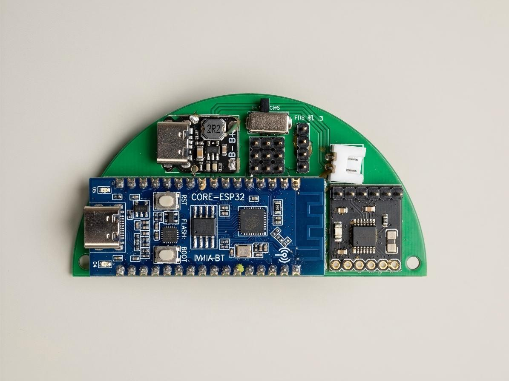
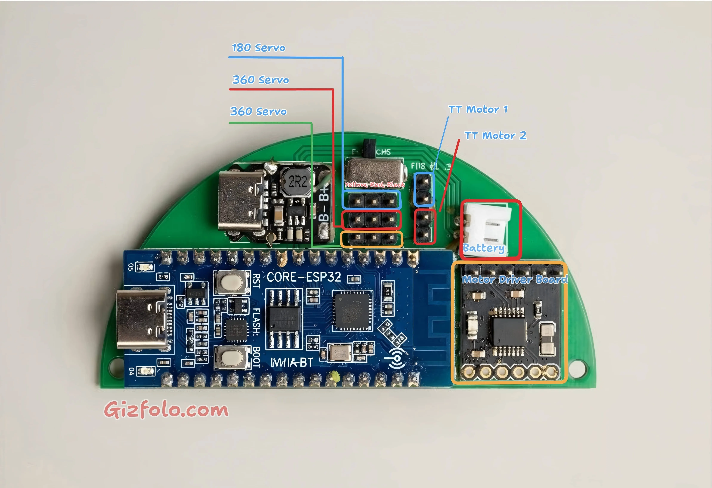

# ESP32-C3 Mini Robo Arm Control Module

English | [简体中文](README.md)

This is firmware for a compact robot arm based on the ESP32-C3. A browser-based interface controls two 360° continuous-rotation servos, one 180° positional servo, and one TT DC motor. The web assets are stored in LittleFS, and control commands are transmitted in real time over WebSocket.

> This document reflects the current repository code. The firmware supports STA mode, AP mode, and a configuration hotspot when an STA connection fails.

## Project Gallery



| Internal construction | Controller board |
| --- | --- |
|  |  |

Online serial terminal: <https://googlechromelabs.github.io/serial-terminal/>

## Features

- Responsive web control panel in English and Chinese
- Real-time WebSocket control with a heartbeat broadcast every second
- Short press to run for a configured duration from `0.1` to `5.0` seconds
- Press and hold for more than 300 ms to run continuously; release to stop, with a firmware-enforced maximum of 10 seconds
- Emergency stop, individual actuator stop, and automatic stop when WebSocket disconnects
- Non-blocking PWM ramp-up for the TT motor to reduce startup current spikes without delaying network processing
- Motion keepalive sent every 500 ms; actuators stop automatically if no keepalive is received for more than 1.5 seconds
- Strict firmware validation of message types, actuator names, speeds, angles, and run durations
- Left/right stepping, centering, and angle-slider control for the 180° servo
- Control parameters and UI language stored in browser `localStorage`
- Wi-Fi configuration stored in ESP32 `Preferences` (NVS)
- Wi-Fi scanning from the network settings panel, including signal strength and encryption status; select a result to fill in the SSID
- D4/D5 network status LEDs and English-only serial runtime logs
- Deep sleep after five minutes without a WebSocket JSON command

## Hardware and Pin Assignment

| Function | Code definition | GPIO |
| --- | --- | ---: |
| 360° servo 1 | `SERVO1_PIN` | 2 |
| 360° servo 2 | `SERVO2_PIN` | 3 |
| 180° servo | `SERVO3_PIN` | 10 |
| TT motor driver input 1 | `MOTOR_IN1` | 6 |
| TT motor driver input 2 | `MOTOR_IN2` | 7 |
| D4 status LED (active high) | `LED_D4_PIN` | 12 |
| D5 status LED (active high) | `LED_D5_PIN` | 13 |

The continuous-rotation servos use pulse widths from `1000` to `2000 μs`. Both stop points are currently set to `1500 μs`. If a servo creeps while idle, adjust `SERVO1_STOP_US` or `SERVO2_STOP_US` in `src/main.cpp`.

The TT motor must be connected to GPIO 6/7 through a suitable motor driver circuit. Do not drive it directly from the ESP32 GPIO pins. Use a separate power supply with sufficient capacity for the servos and motor, and connect its ground to the ESP32 ground.

### Controller Wiring Reference



## Build Environment and Dependencies

The project uses PlatformIO with the following environment:

- Environment: `airm2m_core_esp32c3`
- Platform: `espressif32@6.7.0`
- Board: `airm2m_core_esp32c3`
- Framework: Arduino
- Partition table: `no_ota.csv`
- File system: LittleFS
- Serial baud rate: `115200`

Dependencies declared in `platformio.ini`:

- `madhephaestus/ESP32Servo@3.0.9`
- `links2004/WebSockets@2.7.2`
- `ESP32Async/ESPAsyncWebServer@3.12.1`
- `ESP32Async/AsyncTCP@3.5.0`
- `bblanchon/ArduinoJson@6.21.6`

## Build and Upload

> **Important:** In addition to uploading the firmware, you must upload the web assets in `data/` to LittleFS separately. Otherwise, the control page may be unavailable or the device may continue to serve an older version. Complete both the firmware upload and `uploadfs` steps below.

1. Install the pinned PlatformIO Core version:

   ```bash
   python -m pip install -r requirements.txt
   ```

2. Open this directory in VS Code with PlatformIO installed.
3. Build the firmware:

   ```bash
   pio run -e airm2m_core_esp32c3
   ```

4. Upload the firmware:

   ```bash
   pio run -e airm2m_core_esp32c3 -t upload
   ```

5. Upload the web assets from `data/` to LittleFS:

   ```bash
   pio run -e airm2m_core_esp32c3 -t uploadfs
   ```

6. Open the serial monitor to view the connection status and device IP address:

   ```bash
   pio device monitor -b 115200
   ```

Serial logs use English text and ASCII status markers such as `[OK]`, `[WARN]`, and `[ERROR]` to avoid character-encoding problems in different serial terminals.

The firmware and LittleFS image must be uploaded separately. If only the firmware is uploaded, the control page may be missing or may remain on an older version. After modifying HTML, CSS, or JavaScript under `data/`, upload LittleFS again.

## Wi-Fi Startup Behavior

The current `setupWiFi()` startup sequence is:

1. Read the stored `mode`, `ssid`, and `password` from the `robot-wifi` NVS namespace.
2. If the stored mode is `ap`, start an open AP immediately.
3. If STA mode has a stored SSID, try to connect to that network with a 15-second timeout.
4. If no SSID is stored and default credentials are configured in the source code, try the default network.
5. If no usable credentials exist or the STA connection fails, start the configuration hotspot automatically.

`DEFAULT_STA_SSID` and `DEFAULT_STA_PASSWORD` are empty by default and do not contain private network credentials.

AP details:

- SSID: `ESP32-ROBOTARM-<CHIP_ID>`
- Password: none
- Address: `192.168.4.1`
- The DNS captive portal redirects common operating-system connectivity checks to the control page.
- `/wifi-reset` clears NVS and restarts the device in configuration-hotspot mode.

In configuration-hotspot or AP mode, open `http://192.168.4.1/`. After a successful STA connection, find the device IP in the serial log or router client list, then open:

```text
http://<DEVICE_IP>/
```

The WebSocket endpoint is:

```text
ws://<DEVICE_IP>:81/
```

### Scanning for and Selecting Wi-Fi

In the **Wi-Fi Settings** section under advanced settings:

1. Set the operating mode to **Join Local Network**.
2. Select **Scan WiFi** next to the SSID field.
3. The results show network names, RSSI values, and encryption status. Only the strongest result for each duplicate SSID is retained, with up to 20 results displayed.
4. Select a network to fill in its SSID, enter the password, and save the configuration.

Scanning is asynchronous. In configuration-hotspot or AP mode, the device temporarily uses AP+STA mode during scanning so that the configuration page remains connected.

## Web Control Behavior

- The default TT motor PWM value is `240`, adjustable from `120` to `255` in the web UI.
- The default speed for both continuous-rotation servos is `130`, adjustable from `30` to `150`. The opposite direction is sent by the frontend as `180 - speed`.
- The default short-press duration is `0.1` seconds, adjustable from `0.1` to `5.0` seconds.
- The long-press threshold is 300 ms, with a maximum run time of 10 seconds. Releasing the pointer, canceling it, or losing pointer capture sends a stop command.
- The 180° servo moves to 90° at startup. Its default step is 30°, its angle range is `0–180°`, and its step range is `5–90°`.
- Emergency stop and WebSocket disconnection stop both continuous-rotation servos and the TT motor. The 180° servo remains at its current position.

## WebSocket Protocol

Clients connect on port `81`. Messages are JSON text.

Run a continuous-rotation servo for a fixed duration:

```json
{"type":"run_duration","motor":"servo1","speed":130,"duration":100}
```

Run the TT motor forward for a fixed duration:

```json
{"type":"run_duration","motor":"motor","speed":240,"duration":500,"forward":true}
```

Start continuous operation, limited by the firmware to 10 seconds:

```json
{"type":"start_continuous","motor":"servo2","speed":130}
```

Stop an individual actuator:

```json
{"type":"stop","motor":"motor"}
```

Set the 180° servo angle:

```json
{"type":"servo180","angle":90}
```

Emergency stop:

```json
{"type":"emergency_stop"}
```

Motion keepalive, sent automatically by the web UI every 500 ms while an actuator is running:

```json
{"type":"control_keepalive"}
```

If no keepalive is received for 1.5 seconds, the firmware stops all running continuous-rotation servos and the TT motor.

Example server heartbeat:

```json
{"type":"heartbeat","mode":"STA","configuredMode":"sta","configurationPortal":false,"timestamp":12345,"uptime":12,"ssid":"YOUR_WIFI","ip":"192.168.1.100","rssi":-48}
```

After an automatic stop, the server broadcasts:

```json
{"type":"motor_stopped","motor":"servo1","reason":"run_limit"}
```

After an emergency stop or WebSocket disconnection, the server broadcasts:

```json
{"type":"safety_stop","reason":"emergency_stop"}
```

Invalid or out-of-range commands receive:

```json
{"type":"command_error","error":"out_of_range"}
```

`motor` may be `servo1`, `servo2`, or `motor`. `duration` is measured in milliseconds and must be from `1` to `5000`. Heartbeats in AP mode also contain a `clients` field.

## HTTP API

### `GET /wifi-info`

Returns the current mode, configured mode, connection status, SSID, IP address, and signal information. It does not return the password.

### `GET /wifi-scan?start=1`

Starts an asynchronous Wi-Fi scan. If the scan has started or is already running, the response is:

```json
{"scanning":true}
```

### `GET /wifi-scan`

Returns the current scan status. After the scan finishes, it returns a deduplicated network list:

```json
{
  "scanning": false,
  "networks": [
    {"ssid": "YOUR_WIFI", "rssi": -48, "secure": true}
  ]
}
```

The first 20 unique, non-hidden SSIDs are returned in scan-signal order.

### `POST /wifi-config`

Accepts `application/x-www-form-urlencoded` fields:

- `mode=sta|ap`
- STA mode requires `ssid`; `password` may be empty

After a successful save, the endpoint returns JSON, stops the actuators immediately, and restarts the device after approximately 1.2 seconds. The stored AP/STA mode takes effect after restart.

### `POST /wifi-reset`

Clears the `robot-wifi` NVS namespace and restarts the device.

## Status and Safety Behavior

- Power-on LED test: D4 and D5 turn on together for one second and then turn off.
- Network available: D4 toggles every two seconds and D5 remains off. STA mode uses Wi-Fi connection status; AP mode uses the number of connected clients.
- Network unavailable: D4 and D5 alternate every 500 ms, including during the initial STA connection attempt.
- D4 and D5 turn off before the device enters deep sleep.
- WebSocket client disconnection immediately stops both continuous-rotation servos and the TT motor.
- When a timed or continuous run limit is reached, the firmware stops the corresponding actuator and broadcasts its state.
- Motion watchdog: the web UI sends `control_keepalive` every 500 ms, and the firmware stops motion if no keepalive is received for more than 1.5 seconds.
- TT motor startup uses a non-blocking state machine, increasing PWM by 10 every 8 ms until the target value is reached.
- Wi-Fi configuration or reset sends the HTTP response, stops all actuators, and then restarts after a short delay.
- Inactivity sleep: five minutes after startup or the last parseable WebSocket JSON message, the device stops its actuators, shuts down networking, and enters deep sleep.
- No deep-sleep wake source is currently configured. An external reset or power cycle is required to wake the device.

## Repository Structure

```text
.
├─ src/main.cpp          Firmware entry point, network services, and actuator control
├─ data/index.html       Web control page
├─ data/style.css        Page styles
├─ data/script.js        Frontend control, status, and Wi-Fi configuration logic
├─ docs/                 Project photos and wiring diagrams in both languages
├─ LICENSE               MIT open-source license
├─ requirements.txt      Pinned PlatformIO Core version
└─ platformio.ini        PlatformIO build and dependency configuration
```

## Open-Source Hardware and Tutorials

- 3D-printable parts: [MakerWorld model](https://makerworld.com.cn/zh/models/1760642) — select the version for third-party servos and a TT motor
- PCB controller board: [OSHWHub open-source hardware project](https://oshwhub.com/tonytang2/esp32-armbot)
- BOM, assembly, flashing, and video tutorials: [Gizfolo Robot Arm tutorial](https://gizfolo.com/p/robot-arm)
- Project demonstration video: [YouTube](https://www.youtube.com/watch?v=KMd7N6MSbM0)

This project is an open-source DIY robot arm control module. Contributions, discussions, and remixes are welcome.

## License

This project is licensed under the [MIT License](LICENSE). Third-party dependencies remain subject to their respective licenses.
